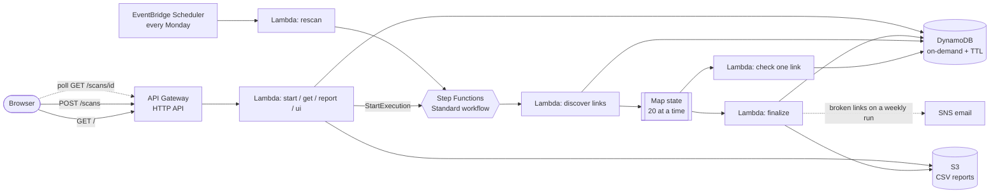

# LinkGuard

Find the dead links in your docs before your readers do.

Paste a docs page or a `sitemap.xml`. LinkGuard checks every link in parallel and sorts them into working, moved, broken and unverified. Optionally it re-checks your site every Monday and emails you when something breaks.

Built for the AWS Builder Center Weekend Challenge: No Pipeline, No Problem. It is fully serverless: no servers, no containers, no CI/CD pipeline. One `sam build` and one `sam deploy` from your laptop.

- Live app: [AppUrl from your deploy]
- Demo video: [video URL]
- Article: [Builder Center article URL]

## How it works



| Service | Job |
| --- | --- |
| API Gateway (HTTP API) | Serves the UI and the JSON API, throttled to 10 requests a second (burst 20) |
| Lambda (Node.js 22, arm64) | Eight small functions with no bundled dependencies, since the AWS SDK v3 ships with the runtime |
| Step Functions (Standard) | Discover the links, check each one in a Map state (20 at a time), finalize. Failures route to a `MarkFailed` step that writes to DynamoDB through a direct service integration, with no Lambda involved |
| DynamoDB | One on-demand table (`pk` / `sk`). A TTL deletes rows after 30 days |
| S3 | A private bucket with one CSV report per scan, deleted after 30 days |
| EventBridge Scheduler | `cron(0 2 ? * MON *)` starts the weekly re-check of watched sites |
| SNS (optional) | Emails you when a weekly re-check finds broken links |

With nobody using it, the only cost is a few KB of storage.

## What the four states mean

| State | Meaning |
| --- | --- |
| Working | 2xx, possibly after a temporary redirect |
| Moved | 2xx, but only after a permanent redirect (301 or 308). Update the link |
| Broken | 404, 410, any other 4xx or 5xx, a domain that doesn't exist, a refused connection, a bad TLS certificate or a redirect loop |
| Unverified | 401, 403, 429, 503, 999, timeouts and network errors. Many sites block bots, so these are listed separately instead of being called broken |

Each link is tried with `HEAD` first and falls back to `GET`, because many servers mishandle `HEAD`. The check stops after the response headers, so it never downloads the page body.

Give it a page and it checks every `<a href>` on it. Give it a sitemap or a sitemap index and it checks every page listed (an index is followed into its first three child sitemaps). Each scan is capped at 300 links (`MAX_LINKS` in `template.yaml`).

## Project layout

```text
template.yaml                     every AWS resource, in one SAM file
statemachine/linkguard.asl.json   the Step Functions workflow
src/                              the eight Lambda functions and their helpers
test/                             13 tests, no AWS account needed
docs/                             demo video script
```

## Deploy

You need the SAM CLI (`winget install Amazon.SAM-CLI` on Windows, then open a new terminal), Node.js 22 and AWS credentials. Run `aws configure`, or set them for the session:

```powershell
$env:AWS_ACCESS_KEY_ID     = "AKIA..."
$env:AWS_SECRET_ACCESS_KEY = "..."
$env:AWS_DEFAULT_REGION    = "us-east-1"
```

Then, from the repo root:

```powershell
sam build
sam deploy --guided
```

At the prompts, name the stack `linkguard`, confirm your region, and leave `AlertEmail` blank (or enter an address for the weekly alerts; SNS sends a confirmation email you must click). SAM warns that four functions "may not have authorization defined". Answer `y` to each, because the API is public on purpose (see Security notes). Accept the defaults for everything else. Your answers are saved to `samconfig.toml`, so later deploys are just `sam build` and `sam deploy`.

When it finishes, the `AppUrl` output is your app. To fetch it again later:

```powershell
$app = (aws cloudformation describe-stacks --stack-name linkguard --query "Stacks[0].Outputs[?OutputKey=='AppUrl'].OutputValue" --output text).TrimEnd('/')
```

Open the `StateMachineArn` output in the Step Functions console to watch the Map state fan out during a scan.

## API

| Method and path | What it does |
| --- | --- |
| `GET /` | The web UI |
| `POST /scans` | Starts a scan. Body: `{"url": "https://docs.example.com/", "watch": true}`. Returns `202` with `{"scanId": "..."}`. `watch` adds the site to the Monday re-check. Returns `400` for an invalid or private address and `409` when the 25-site watch list is full |
| `GET /scans/{scanId}` | Scan status (`RUNNING`, `COMPLETE` or `FAILED`), counts, and every checked link with its `state` (`ok`, `redirect`, `broken` or `unverified`). Returns `404` if the scan doesn't exist or has expired |
| `GET /scans/{scanId}/report.csv` | A CSV of every link that isn't working, broken ones first. Returns `404` until the scan has finished |

Try it from PowerShell:

```powershell
$r = Invoke-RestMethod -Method Post "$app/scans" -ContentType "application/json" -Body '{"url":"https://example.com/"}'
Invoke-RestMethod "$app/scans/$($r.scanId)"
```

## Run the tests

```powershell
npm install   # dev-only: the AWS SDK, for the end-to-end test
npm test
```

The suite covers link extraction, sitemap parsing, SSRF protection, link classification against a local test server (redirects, HEAD fallback, gzip, timeouts), and an end-to-end run of every handler against in-memory fakes of DynamoDB, S3, SNS and Step Functions, including the Monday re-check and alert.

## Security notes

LinkGuard fetches addresses that strangers type into a form, so it treats them as hostile.

- SSRF guard. Private, loopback, link-local (including the cloud metadata address), multicast and IPv4-mapped IPv6 ranges are refused. The check runs inside a custom DNS lookup at connect time, which defeats DNS rebinding, and again on every redirect hop.
- Only `http` and `https` on ports 80, 443, 8080 and 8443. No URLs with credentials. At most 5 redirects. Pages and sitemaps are read up to 3 MB.
- The UI renders remote data with `textContent` only. CSV cells are neutralised against spreadsheet formula injection.
- Scan IDs are random UUIDs, and scans and reports expire after 30 days. Anyone with a scan link can view that scan.
- API throttling is on. For a public production deployment, add an AWS WAF rate-based rule and authentication.

## Cost

Step Functions Standard bills per state transition. A 300-link scan is roughly a thousand transitions, about 2.5 cents at $0.025 per thousand (check your region's price). Lambda, DynamoDB and API Gateway usage at this scale falls within or near the free tier.

## Known limitation

If a Check invocation fails outright after its retries, the Map catches it so the rest of the scan continues, but that link gets no result row. It is missing from the report instead of listed as unverified.

## Clean up

CloudFormation won't delete a bucket that still has reports in it, so empty it first:

```powershell
$bucket = aws cloudformation describe-stacks --stack-name linkguard --query "Stacks[0].Outputs[?OutputKey=='ReportBucketName'].OutputValue" --output text
aws s3 rm "s3://$bucket" --recursive
sam delete --stack-name linkguard
```

## Ideas for next steps

- Write an unverified row for a link whose check fails outright.
- Switch the Map state to a Distributed Map reading links from S3, to check tens of thousands of them.
- Crawl internal pages recursively and diff scans, so only newly broken links are reported.
- Add Cognito sign-in and a watch list per user.